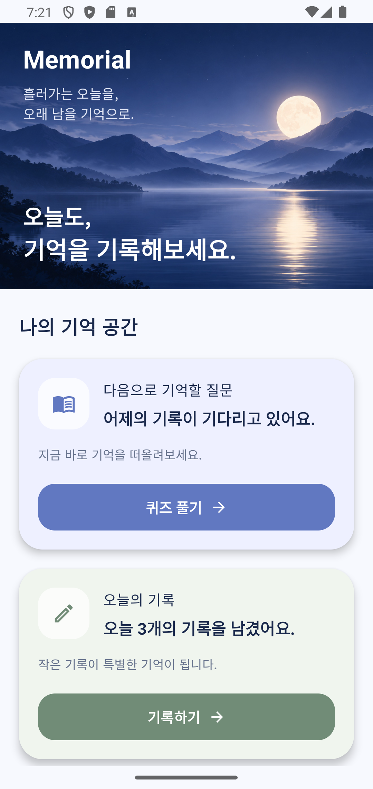
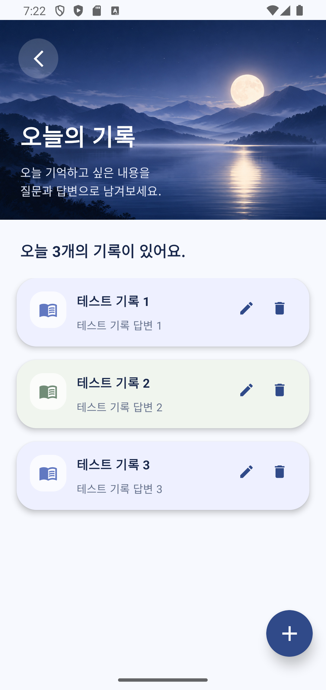
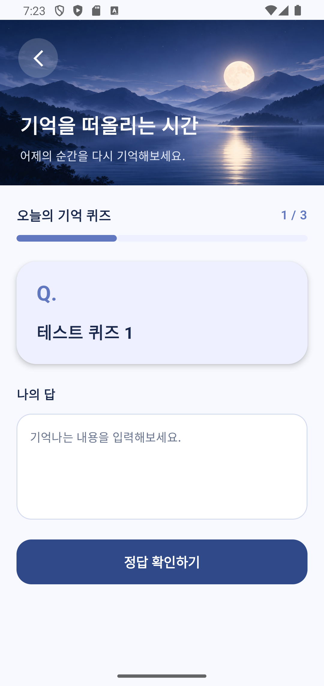
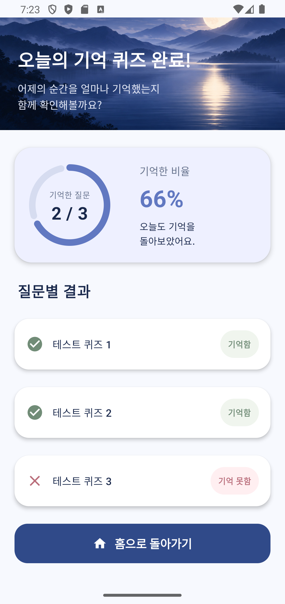

# 🌙 Memorial

### 하루의 경험을 기록하고, 다음 날 다시 떠올리는 기억 회상 Android 앱

Memorial은 일상에서 경험한 일을 질문과 답변으로 기록하고,
다음 날 퀴즈를 통해 스스로 회상할 수 있도록 돕는 Android 애플리케이션입니다.

단순히 기록을 저장하고 다시 읽는 방식에서 벗어나,
사용자가 직접 기억을 떠올리고 평가하는 **능동 회상(Active Recall)** 방식을 적용했습니다.

Kotlin과 Jetpack Compose를 기반으로 개발한 개인 프로젝트이며,
Room, MVVM, StateFlow, Coroutine 등을 활용하여 로컬 데이터 저장과 UI 상태 관리를 구현했습니다.

## 📌 개발 배경

일상에서 경험한 일들은 시간이 지나면서 잊히기 쉽습니다.

이를 해결하기 위해 하루 동안 기억하고 싶은 경험을 질문과 답변으로 기록하고,
다음 날 정답을 확인하기 전에 스스로 답변을 떠올리는 앱을 기획했습니다.

Memorial은 다음과 같은 흐름을 중심으로 설계했습니다.

**기록 작성 → 다음 날 회상 → 정답 확인 → 기억 여부 평가**

정답을 자동으로 채점하기보다는, 사용자가 자신의 기억 여부를 직접 판단하도록 구성했습니다.

## ✨ 주요 기능

### 1. 오늘의 기록

- 질문과 답변 작성
- 기존 기록 수정 및 삭제
- 작성 시각 저장
- 오늘 작성한 기록 목록 조회

### 2. 다음 날 기억 회상 퀴즈

- 전날 작성한 기록을 퀴즈로 제공
- 원래 답변을 숨기고 질문 먼저 표시
- 사용자가 기억나는 답변 입력
- 원래 답변 확인

### 3. 기억 여부 자기평가

- '기억함 / 기억 못함' 선택
- 평가 결과를 Room 데이터베이스에 저장
- 완료 후 질문별 기억 결과 확인
- 퀴즈 다시 풀기 지원

### 4. 로컬 데이터 관리

- Room을 활용한 기기 내부 데이터 저장
- Flow를 활용한 데이터 변경 관찰
- StateFlow를 활용한 UI 상태 관리
- Coroutine을 활용한 비동기 데이터 작업

## 📱 앱 스크린샷

|                      홈                       |                       기록                       |                      퀴즈                      |                       결과                       |
|:--------------------------------------------:|:----------------------------------------------:|:--------------------------------------------:|:----------------------------------------------:|
|  |  |  |  |

### 화면별 기능

- **홈:** 오늘의 기록 현황 및 퀴즈 진행 상태 확인
- **기록:** 질문과 답변 작성, 수정 및 삭제
- **퀴즈:** 전날 기록을 바탕으로 답변 회상 및 자기평가
- **결과:** 질문별 기억 여부와 기억한 질문 수 확인

## 🛠 기술 스택

| 분류               | 기술                 | 사용 목적                       |
|------------------|--------------------|-----------------------------|
| Language         | Kotlin             | Android 앱의 주요 로직 구현         |
| UI               | Jetpack Compose    | 선언형 UI 구현 및 상태에 따른 화면 갱신    |
| Architecture     | MVVM               | UI와 데이터 처리 로직의 역할 분리        |
| Database         | Room               | 질문, 답변, 작성 시각 및 기억 평가 결과 저장 |
| Data Access      | DAO, Repository    | 데이터베이스 접근과 데이터 처리 로직 분리     |
| State Management | StateFlow          | ViewModel의 상태를 UI에 전달       |
| Asynchronous     | Coroutine, Flow    | 비동기 데이터 작업 및 데이터 변경 관찰      |
| Navigation       | Navigation Compose | 화면 간 이동 관리                  |

## 🏗 아키텍처

Memorial은 **MVVM(Model-View-ViewModel)** 패턴을 기반으로 구성했습니다.

UI와 데이터 처리 로직을 분리하고, Room 데이터베이스의 변경 사항이 화면에 반영되도록 단방향 데이터 흐름을 적용했습니다.

### 데이터 흐름 (조회 및 UI 상태 전달)

```text
Room Database
      ↓
     DAO
      ↓
  Repository
      ↓
   ViewModel
      ↓
   StateFlow
      ↓
     Route
      ↓
 Compose Screen
```
사용자 이벤트는 Screen → Route → ViewModel로 전달되며,
데이터 저장 및 수정은 ViewModel → Repository → DAO를 통해 수행됩니다.

### 계층별 역할

**1. Room / DAO**

- Room을 사용해 기록 데이터를 기기 내부에 저장합니다.
- DAO에서 기록 추가, 수정, 삭제 및 날짜별 조회 기능을 정의합니다.
- Flow를 반환하는 조회 함수를 통해 데이터 변경을 관찰합니다.

**2. Repository**

- ViewModel과 DAO 사이에서 데이터 접근을 담당합니다.
- 오늘과 어제의 날짜 범위를 계산해 기록을 조회합니다.
- 데이터베이스 관련 로직이 UI 계층에 직접 노출되지 않도록 분리했습니다.

**3. ViewModel**

- Repository에서 제공하는 데이터를 받아 UI 상태를 관리합니다.
- StateFlow를 이용해 화면에서 필요한 상태를 전달합니다.
- Coroutine을 이용해 데이터 저장과 같은 비동기 작업을 수행합니다.
- 퀴즈 진행 상태, 현재 문제, 기억 여부 평가 등 화면 로직을 관리합니다.
- 생성자에서 Repository를 필요로 하는 ViewModel을 생성하기 위해 ViewModelFactory를 사용했습니다.
- Factory를 통해 ViewModel에 필요한 Repository를 전달하여 의존성을 주입했습니다.
- 이를 통해 ViewModel이 Repository 객체를 직접 생성하지 않고 외부에서 전달받도록 구성했습니다.

**4. Route**

- ViewModel의 StateFlow를 구독하고 UI에 전달합니다.
- 사용자 이벤트를 ViewModel과 연결합니다.
- 화면 전환 및 다이얼로그 표시 등의 UI 흐름을 관리합니다.

**5. Screen**

- 전달받은 상태에 따라 Compose UI를 구성합니다.
- 사용자 입력과 버튼 클릭을 콜백으로 상위 계층에 전달합니다.
- 데이터베이스나 Repository에 직접 접근하지 않도록 구성했습니다.

### ViewModelFactory를 선택한 이유

Memorial은 단일 Room 데이터베이스와 Repository를 중심으로 구성된 소규모 개인 프로젝트입니다.

현재 의존성 구조에서는 Hilt와 같은 DI 프레임워크를 도입하기보다, ViewModelFactory를 이용해 필요한 Repository를 직접 전달하는 방식을 선택했습니다.

이를 통해 추가적인 라이브러리 설정 없이 생성자 주입을 구현하고, ViewModel이 Repository 생성 책임을 갖지 않도록 분리했습니다.

향후 의존성 관계가 복잡해지거나 관리해야 할 객체가 늘어난다면 Hilt 도입을 검토할 계획입니다.

### 설계 의도

**관심사 분리(Separation of Concerns)** 를 중심으로 각 계층의 역할을 구분했습니다.

특히 Route와 Screen을 분리하여 상태 수집 및 이벤트 연결 로직과 실제 UI 구현을 구분했습니다.

이를 통해 UI 디자인을 수정할 때 데이터 처리 로직에 미치는 영향을 줄이고, 기능별 코드의 역할을 명확하게 유지하고자 했습니다.

## 🔧 트러블슈팅

### 1. 비동기 데이터 저장 완료 전 UI가 종료되는 문제

**문제 상황**

기록 추가·수정 시 ViewModel에서 Coroutine으로 Room 데이터 저장을 요청한 직후, 저장 완료 여부와 관계없이 BottomSheet가 닫히는 문제가 있었습니다.

저장에 실패하더라도 입력 화면이 닫힐 수 있어 사용자가 작성한 내용을 잃어버릴 위험이 있었습니다.

**원인 분석**

`viewModelScope.launch`는 Coroutine을 실행하지만, 호출한 쪽에서 데이터 저장이 완료될 때까지 기다리는 것은 아닙니다.

기존 Route에서는 ViewModel의 저장 함수를 호출한 직후 `showBottomSheet = false`를 실행하고 있었습니다.

**해결 방법**

- ViewModel의 데이터 저장 로직에 `try-catch-finally`를 적용했습니다.
- `onResult` 콜백으로 저장 성공·실패 결과를 Route에 전달했습니다.
- 저장 성공 시에만 BottomSheet가 닫히도록 변경했습니다.
- `isSaving`을 이용해 저장 중 중복 요청을 방지했습니다.
- Coroutine 취소는 `CancellationException`을 재전파하도록 처리했습니다.

**배운 점**

비동기 작업의 시작과 완료는 다르며, 데이터 저장 결과에 따라 UI 상태를 변경해야 한다는 점을 이해했습니다.

또한 ViewModel은 데이터 작업을 처리하고 Route는 그 결과에 따라 화면을 제어하도록 역할을 분리했습니다.

### 2. 퀴즈 결과 저장 실패 및 중복 요청 처리

**문제 상황**

퀴즈 마지막 문제의 평가 결과를 Room에 저장할 때 예외 처리가 없었으며, 평가 버튼을 빠르게 여러 번 누르면 중복 저장 작업이 시작될 가능성이 있었습니다.

**해결 방법**

- 퀴즈 결과 저장에 예외 처리를 추가했습니다.
- 저장 실패 시 오류 메시지를 표시하도록 변경했습니다.
- 저장 중에는 추가 저장 요청을 무시하도록 처리했습니다.
- 저장에 성공한 후에만 퀴즈 완료 상태로 변경하도록 구성했습니다.

**배운 점**

Coroutine을 사용하는 데이터 저장 로직에서는 예외 처리뿐 아니라 중복 실행과 UI 상태 변경 시점도 함께 고려해야 한다는 점을 배웠습니다.

---

## 🤖 AI 개발 도구 활용

### 사용 도구

- **ChatGPT:** Android 개념 학습, 코드 구현 방향 검토, UI 디자인 탐색
- **Codex:** 프로젝트 소스코드 분석, 코드 리뷰 및 개선 사항 확인

### 활용 과정

**1. 문제 발견**

Codex를 활용하여 전체 프로젝트의 소스코드를 검토하고, 데이터 저장 예외 처리 누락과 상태 관리 관련 위험을 확인했습니다.

**2. 원인 분석 및 학습**

ChatGPT를 통해 Coroutine, StateFlow, ViewModel 등 관련 개념을 학습하고 문제의 원인과 해결 방법을 검토했습니다.

**3. 개선 사항 적용**

AI가 제안한 내용을 모두 적용하지 않고, 실제 기능 안정성에 영향을 주는 항목을 우선적으로 수정했습니다.

반면 프로젝트 규모에 비해 복잡한 의존성 주입 구조 변경이나 불필요한 추상화는 보류했습니다.

**4. 코드 재검토**

수정한 코드를 다시 검토하여 저장 결과 콜백, 예외 처리, 중복 요청 방지 등이 의도한 구조로 연결되었는지 확인했습니다.

### AI 활용을 통해 배운 점

AI 개발 도구를 단순한 코드 생성 수단으로 사용하기보다, 문제를 발견하고 해결 방향을 탐색하며 코드의 동작을 이해하는 데 활용했습니다.

AI가 제안한 수정 사항도 프로젝트의 목적과 규모에 맞는지 검토한 후 선택적으로 적용했습니다.

이를 통해 AI 도구를 활용한 개발 과정에서도 **코드의 동작을 이해하고 검증하는 과정이 중요하다**는 점을 배웠습니다.

## 📝 개발 회고

### 1. Android 데이터 흐름에 대한 이해

Memorial을 개발하면서 Room, DAO, Repository, ViewModel, StateFlow, Jetpack Compose를 연결하는 과정을 경험했습니다.

초기에는 각 계층의 역할과 데이터가 화면까지 전달되는 과정이 익숙하지 않았지만, 기능을 단계별로 구현하면서 각 계층의 책임을 이해할 수 있었습니다.

특히 ViewModel과 Repository의 역할을 구분하고, Flow로 전달된 데이터가 StateFlow를 통해 Compose UI에 반영되는 구조를 학습했습니다.

### 2. UI와 비즈니스 로직의 책임 분리

Jetpack Compose를 사용하면서 UI 상태와 이벤트를 어떻게 관리해야 하는지 고민했습니다.

Route와 Screen을 분리하여 Route는 ViewModel의 상태 수집과 이벤트 연결을 담당하고, Screen은 전달받은 상태를 기반으로 UI를 구성하도록 설계했습니다.

이를 통해 UI 코드와 데이터 처리 로직을 분리하는 것의 중요성을 이해했습니다.

### 3. 비동기 작업과 예외 처리

Room을 이용한 데이터 저장 기능을 구현하면서 Coroutine을 통한 비동기 처리와 작업 완료 시점의 차이를 학습했습니다.

초기에는 데이터 저장을 요청한 직후 입력창을 닫도록 구현했지만, 이후 저장 성공 여부를 확인한 뒤 UI 상태를 변경하도록 개선했습니다.

이 과정에서 예외 처리와 중복 실행 방지가 앱의 안정성에 중요한 역할을 한다는 점을 배웠습니다.

---

## 🚀 향후 개선 계획

현재 Memorial은 핵심 기능 구현을 완료한 MVP 단계이며, 향후 기록 관리 기능과 사용자 편의성, 코드 안정성을 개선할 계획입니다.

### 1. 캘린더 기반 날짜별 기록 조회

현재 Memorial은 오늘 작성한 기록을 조회하고, 전날의 기록을 퀴즈로 제공하는 구조입니다.

향후 캘린더 기능을 추가하여 사용자가 원하는 날짜를 직접 선택하고, 해당 날짜에 작성한 기록을 확인할 수 있도록 개선할 계획입니다.

- 캘린더 UI를 통한 날짜 선택
- 선택한 날짜의 기록 목록 조회
- 과거 기록을 날짜별로 확인하는 기능 제공

### 2. 알림 기능

사용자가 일상의 기록 작성과 기억 회상 퀴즈를 꾸준히 진행할 수 있도록 알림 기능을 추가할 계획입니다.

- 오늘의 기록 작성 알림
- 전날 기록에 대한 기억 회상 퀴즈 알림
- 사용자가 알림 시간을 설정할 수 있는 기능

### 3. 코드 품질 및 테스트 강화

현재 구현된 기능의 안정성과 유지보수성을 높이기 위해 테스트 코드를 보강하고, 필요한 부분을 지속적으로 개선할 계획입니다.

- ViewModel 및 Repository 단위 테스트 추가
- 기록 추가·수정·삭제 및 퀴즈 결과 저장에 대한 테스트 강화
- 저장 실패, 퀴즈 재응시 등 주요 예외 상황 검증
- 기존 MVVM 구조를 유지하면서 코드 중복 및 불필요한 로직 개선

이를 통해 사용자가 과거의 기록을 편리하게 확인하고 꾸준히 기억을 회상할 수 있도록 기능을 확장하는 동시에, 안정적이고 유지보수하기 쉬운 앱으로 발전시키고자 합니다.